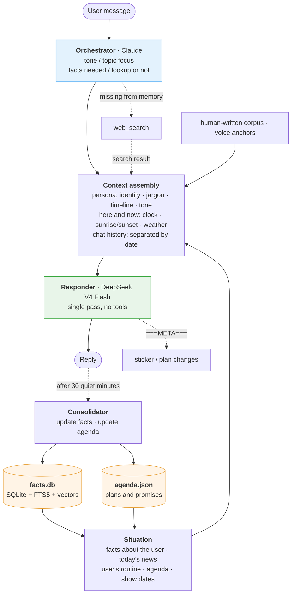
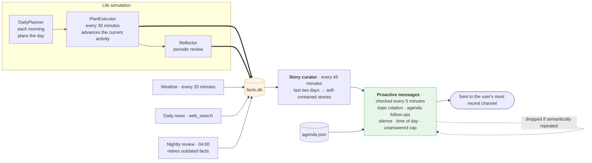

# Lingxi

[中文](README.md) | English

Lingxi is a persona agent with a configurable character, built to hold conversations that feel like talking to a real person. It simulates someone with a daily life, long-term memory and opinions of their own, rather than a system that answers questions.

> The name comes from the Chinese idiom 心有灵犀: two people who understand each other without needing to say it.

Three design choices set it apart from typical role-play bots:

- **A simulated daily life.** In the background, the character gets a schedule each day, which is advanced into concrete activities throughout the day and reviewed periodically. The experiences the character mentions in conversation are events that were actually simulated that day.
- **Memory is the only state.** There are no emotion scores and no state machine. The character's current state is whatever happened most recently in their memory stream, following the design of [Generative Agents](https://arxiv.org/abs/2304.03442).
- **Thinking and speaking are done by two models.** Orchestration runs on Claude. The reply is written in a single pass by a model that is native in the conversation language, and that pass calls no tools, so the voice stays consistent.

## Features

### Conversation

- **Long-term memory.** Once a conversation has been quiet for 30 minutes, a consolidator reads the whole conversation together with existing memories and adds, updates or retires facts about the user. Every change must quote the conversation as evidence. A nightly review additionally retires facts that are no longer true, such as plans whose date has passed.
- **Plans and promises.** Dated plans the user mentions, and promises the character makes, are recorded as separate items in an agenda. The character follows up the day before, on the day and over the following few days, at most one item per day. An item is dropped after a follow-up goes unanswered.
- **Time and place.** The character uses the real clock, computes sunrise and sunset from their location, and receives live weather. Chat history is separated by date, so events from several days ago are not mistaken for yesterday. Dates in the persona (birthdays, anniversaries, performances) are converted into ages, intervals or countdowns at generation time.
- **Web lookup.** When the orchestrator decides a turn needs an external fact, a web search runs first and its result is passed to the responder as background. An empty result means only that the character has not seen the news yet; it is never used to contradict the user.
- **Image understanding.** Images are first described in text by a vision-capable model; screenshots with a lot of text are transcribed line by line. The description is also stored in short-term memory, so later turns can still refer to the image.
- **Stickers.** Stickers are retrieved and sent by emotional meaning.
- **Message batching.** Several short messages sent in a row are merged into one turn after a brief pause.
- **Voice anchoring.** Each turn retrieves example sentences from a corpus of human-written lines to keep the character's voice stable. A voice monitor tracks surface features of the character's recent messages (exclamation rate, self-reference, and so on) and adds a correction to the next turn when they drift outside the range the persona declares.

### Proactive messages

- **Material from the character's own life.** Every 45 minutes, a story curator reads the character's last two days and today's news, and writes a few short stories that make sense without context: people are introduced by their relationship to the character, and works and events are given their full names on first mention. Proactive messages draw from these stories, and a story already told is not told again.
- **Topic rotation.** The topic categories of the two most recent proactive messages are set aside for the next one, except for news.
- **Pacing.** Checked every 5 minutes, taking into account how long the user has been silent, the relationship stage, the time of day and quiet hours. After two unanswered messages in a row the character stops, and the interval before the next attempt grows exponentially. Time slots that have long gone unanswered are skipped.
- **Deduplication.** Each message is compared semantically with recent ones before sending and dropped if it is too similar.
- **Welcome back.** When the user returns after a long silence, the character says once that they were missed, then carries on as usual.

### Channels

- **Feishu (Lark) bot.** Streaming card output and reply rating buttons.
- **QQ private chat.** Built on the official QQ bot platform (API v2). Replies are streamed, and each paragraph is sent as soon as it is finished. A QQ account can be linked to an existing Feishu identity with a single-use pairing code, after which both share the same memory. Proactive messages go to the channel the user used most recently.
- **Other entry points.** A web API, a command-line client, and a desktop pet that notices when the user is programming.

### Persona

Identity, personality, speaking style, jargon, biography, relationships and areas of interest are all defined in YAML. Data is stored per persona under `data/personas/<id>/`, so personas never share memory.

## Quick start

```bash
python3.12 -m venv .venv && source .venv/bin/activate
pip install -e ".[feishu,embeddings,vector-db]"   # add api for the web API, pet for the desktop pet

cp .env.example .env      # fill in keys, see the table below
lingxi                    # chat in the terminal
```

Everything except `PERSONA_PATH` can be left empty at first; the startup log reports anything that is missing.

| Variable | Purpose |
|---|---|
| `PERSONA_PATH` | Path to the persona file. Changing it switches persona, and memory switches with it |
| `DEEPSEEK_API_KEY` | Responder model (DeepSeek V4 Flash by default) |
| `ARK_API_KEY` + `EMBEDDING_MODEL` | Semantic retrieval (Volcengine Ark endpoint `ep-xxx`). Falls back to keyword matching when unset |
| `FEISHU_APP_ID` / `FEISHU_APP_SECRET` | Feishu bot |
| `QQ_BOT_APP_ID` / `QQ_BOT_APP_SECRET` | QQ private chat, started inside the `lingxi-feishu` process |
| `QQ_LINK_HOME` / `QQ_LINK_CODE` | Optional. A QQ account that sends the pairing code is linked to the existing identity named by `QQ_LINK_HOME` (e.g. `feishu:oc_xxx`). The code works only once |

Orchestration uses Claude. It reads the local Claude Code login first; alternatively run `lingxi login anthropic` or set `ANTHROPIC_API_KEY`.

Commands:

| Command | Description |
|---|---|
| `lingxi` | Command-line chat |
| `lingxi-feishu` | Feishu bot (also starts QQ when configured) |
| `lingxi-server` | Web API |
| `lingxi-pet` | Desktop pet |
| `lingxi-eval` | Behavioral regression tests |
| `lingxi-annotate` | Reply annotation and corpus maintenance |

## Writing a persona

`config/personas/example_persona.yaml` is a minimal template, and `config/personas/tangkeke.yaml` is a complete example to consult for how each field is written in practice. Point `PERSONA_PATH` at the new file when it is ready.

Main fields:

| Field | Description |
|---|---|
| `identity.birthdate`, `anchors` | Dates, not ages or year counts. Age, years since debut and similar values are computed for the current day |
| `upcoming_shows` | Dates of performances or events the character will attend, turned into countdowns |
| `biography.recurring_people` | People around the character and how they are related. The story curator uses this to introduce someone when they come up |
| `lexicon` | Jargon from the character's field. A model cannot tell when it does not understand an abbreviation and will not look it up, so the field's abbreviations must be written in; otherwise they are read literally |
| `world_interests` | Topics for the daily news search |
| `register_notes` | How a given tone category looks on this particular character. Without it a generic description is used, which tends toward stereotype |
| `message_habits` | Typing habits: sentence breaks, punctuation, how many messages are sent at once |
| `voice_baseline` | Target ranges for the voice monitor (exclamation rate, self-reference, etc.). Leave empty to disable monitoring |
| `location` | Determines sunrise, sunset and weather |
| `responder` | Responder model (`deepseek` / `doubao` / `main`). Model IDs are read from `.env` and never stored in the repository |

When writing prompt-like fields, prefer positive examples over lists of things to avoid. Many negative instructions concentrate the model's attention on exactly what they forbid, which makes it more likely to appear.

## Architecture

### Conversation path

The orchestrator decides how to respond, which facts are needed and whether to look something up; the responder then writes the reply in one pass with the full context.



Replies and proactive messages read shared state through the same `Situation`, so both see the same information at the same moment.

### Background path

Proactive messages draw on the life simulation and the news search running in the background:



## Operations

The scripts in `scripts/` are read-only or idempotent and suitable for launchd, cron or similar schedulers:

| Script | Description |
|---|---|
| `backup_data.py` | Snapshots every persona's data: databases are copied online through the SQLite backup API, other files as hard-linked incremental snapshots |
| `health_check.py` | Checks that the process is alive and its log is still being written; sends one system notification on failure and one on recovery |
| `weekly_report.py` | Weekly reply rate and topic mix of proactive messages, plus voice metrics |
| `qq_probe.py` | Checks QQ bot credentials, gateway connectivity, and whether proactive messages are allowed |

## Development

```bash
pip install -e ".[dev,feishu,embeddings,vector-db,api]"
pytest -q          # all tests should pass
ruff check src
```

### Layout

```
src/lingxi/
├── persona/       # persona YAML, data models, prompt building, voice monitor
├── facts/         # single fact store: store (SQLite/FTS5/vectors), retriever, scorer, reflector
├── memory/        # short-term memory, post-conversation consolidator, agenda
├── brain/         # orchestrator, fact rendering, pre-turn web lookup
├── conversation/  # conversation engine, shared situation, output parsing and cleanup, images
├── planner/       # life simulation (DailyPlanner, PlanExecutor), story curator
├── temporal/      # clock, sunrise/sunset, weather, interaction tracking, proactive scheduling
├── world/         # daily news search
├── stickers/      # sticker store, semantic retrieval, visual tagging
├── fewshot/       # human-written corpus and annotation queue
├── evals/         # behavioral regression: freeze real context, replay, sample, judge
├── providers/     # LLM and embedding abstractions
├── channels/      # Feishu, QQ, cross-channel identity mapping, message batching
├── web/           # web API
└── pet/, desktop/ # desktop pet window and activity sensing
```

### Conventions

1. **New state goes into facts.db first.** facts.db is the single source of truth. Before adding any new memory or state store, check whether it can be expressed as a typed fact with an expiry. Only items with a date whose progress must be tracked (such as the agenda) are modeled separately.
2. **Real conversation data never enters the repository.** `data/`, `evals/cases/*.yaml` and `evals/baseline.json` are in `.gitignore` because they contain real users' conversations. Tools must not export them as artifacts either. Tests and examples use invented content only.
3. **Run the behavioral regression after changing prompt assembly.** See below.
4. **Persona differences belong in YAML, not code.** A specific persona's name appearing in code usually means a configuration field is missing.

### Behavioral regression

```bash
lingxi-eval                            # run all cases and compare with the baseline
lingxi-eval <case-id> --dump DIR       # run one case and write N replies to a directory
lingxi-eval --baseline                 # accept the current results as the new baseline
lingxi-eval --capture <recipient_key>  # generate a case skeleton from live state
```

Each case freezes the clock, facts, chat history, web lookup results and agenda, **replays them through the real context-assembly pipeline**, samples N replies and scores them with deterministic detectors. Freezing the final prompt would miss most problems, because changes usually land in the assembly layer.

In addition, `tests/test_evals/test_prompt_snapshots.py` keeps snapshots of the complete prompts for both the reply path and the proactive path. When a prompt change is intended, regenerate them with `UPDATE_SNAPSHOTS=1` and commit them in the same commit.

Principles for writing detectors:

- **Validate the detector before judging the agent.** Wrong replies can be phrased in endless ways, while what a correct reply must contain is usually finite, so define the check from the correct side. If the detector is off, no "fixed" conclusion can be trusted.
- **Set thresholds from measured distributions.** Do not adjust them after a single run; resample if they need to change.
- **Report BROKEN, not PASS, when a premise no longer holds.** A case that fails silently gives false confidence and is worse than no case.

Distinctions a detector cannot make reliably belong in deterministic unit tests, not in cases.

### Corpus annotation

`lingxi-annotate` ranks recorded replies by how AI-like they read, most AI-like first:

```bash
lingxi-annotate                                   # show the queue
lingxi-annotate --fix <turn_id> 'rewritten line'  # submit a rewrite, highest weight
lingxi-annotate --good <turn_id>                  # mark as a positive example
```

Rewrites enter the corpus as human-written lines and are later retrieved by meaning to anchor the character's voice. The same annotation buttons appear under every reply in Feishu. **Positive examples are human-written lines only**: samples produced by the model carry the very problems being corrected, and using them as positives reinforces those problems.

## License

[AGPL-3.0-or-later](LICENSE)

Free to use and modify. If you offer Lingxi (including modified versions) to others as a network service (SaaS or hosted), you must release the complete server-side source code under the AGPL. For a closed-source commercial license, contact the author.
