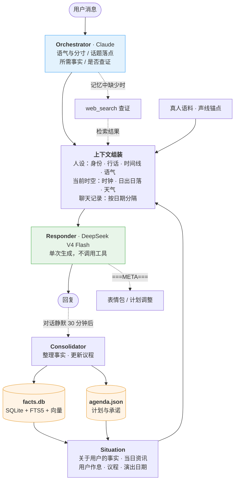
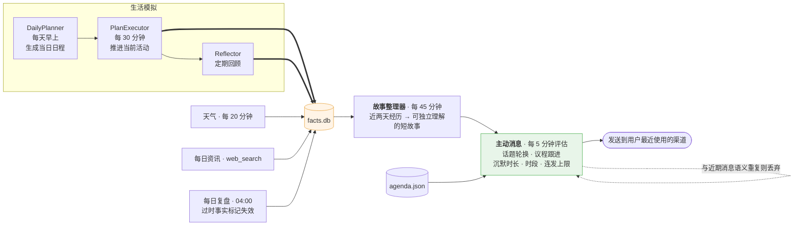

# 灵犀 / Lingxi

Lingxi 是一个可定制人设的虚拟人格 agent，目标是提供接近真人的对话体验。它模拟的是一个拥有自己的日常生活、长期记忆和主观判断的人，而不是一个应答系统。

> 名称取自「心有灵犀」。

与常见的角色扮演机器人相比，Lingxi 有三项核心设计：

- **独立的生活模拟。** 后台每天为角色生成日程，按时段推进为具体活动，并定期回顾。角色在对话中提到的经历，来自当天实际模拟出的事件。
- **记忆是唯一的状态来源。** 系统不维护情绪数值或状态机。角色的当前状态由记忆流中最近发生的事件决定，设计参考 [Generative Agents](https://arxiv.org/abs/2304.03442)。
- **思考与表达由两个模型分工。** 编排由 Claude 完成；对外发言由中文母语模型单次生成，发言阶段不调用任何工具，以保证语言风格连贯。

## 功能概览

### 对话

- **长期记忆。** 每段对话结束并静默 30 分钟后，整理器通读整段对话和已有记忆，对关于用户的事实执行新增、更新或失效操作，每条变更都必须引用对话原文作为依据。每天凌晨另有一次复盘，将已经过时的事实标记为失效，例如已经结束的计划。
- **约定与计划。** 用户提到的有日期的计划、角色做出的承诺，会以独立条目记录在议程中。角色会在前一天、当天及之后几天跟进，每天最多跟进一项；某次跟进未获回复后，该条目不再提起。
- **时间与地点感知。** 使用真实时钟，按角色所在地经纬度计算日出日落，并接入实时天气。聊天记录按日期分隔，避免把几天前的事误当作昨天。人设中的日期（生日、纪念日、演出日）在生成时按当天换算为年龄、间隔或倒计时。
- **联网查证。** 当编排器判断本轮需要外部事实时，会先执行一次网络检索，再将结果作为背景交给发言模型。检索无结果时，仅表示角色尚未看到相关消息，不作为否定用户说法的依据。
- **图片理解。** 图片先由具备视觉能力的模型转写为文字描述，含大量文字的截图会逐行转写。描述同时写入短期记忆，后续轮次仍可引用。
- **表情包。** 根据情绪语义检索并发送表情包。
- **消息合并。** 用户连续发送的多条短消息会在短暂静默后合并为一轮处理。
- **声线锚定。** 每轮从真人语料池中按语义检索示例句，用于稳定角色的语言风格。语气监测器持续统计角色近期消息的表面特征（感叹号比例、自称方式等），偏离人设声明的区间时在下一轮给出纠正提示。

### 主动消息

- **素材来自角色自己的生活。** 故事整理器每 45 分钟读取角色最近两天的经历与当天的资讯，整理成几条无需上下文即可理解的短故事：涉及的人物会注明与角色的关系，作品和活动首次出现时使用全称。主动消息从这些故事中选材，已讲过的故事不会重复讲。
- **话题轮换。** 最近两条主动消息涉及的话题类别会暂时回避，资讯类除外。
- **发送节奏。** 每 5 分钟评估一次，综合考虑沉默时长、关系阶段、当前时段与静默时段。连续发送两条未获回复后暂停，之后的重新尝试间隔按指数递增；长期无回复的时段会被跳过。
- **去重。** 发送前与近期消息做语义比对，相似度过高则不发送。
- **回归问候。** 用户在较长时间未回复后再次出现时，角色会自然地表达一次想念，随后照常聊天。

### 渠道

- **飞书机器人。** 支持流式卡片输出与回复评价按钮。
- **QQ 私聊。** 基于 QQ 官方机器人平台（API v2）。回复以流式方式逐条发送，每段写完即发出。QQ 账号可以通过一次性配对码与已有的飞书身份绑定，绑定后共享同一份记忆。主动消息发往用户最近使用的渠道。
- **其他入口。** Web API、命令行，以及可感知用户编程活动的桌面宠物。

### 人设

身份、性格、说话风格、行话、传记、人际关系、关注领域均在 YAML 中定义。数据按人设独立存放于 `data/personas/<id>/`，不同人设之间互不影响。

## 快速开始

```bash
python3.12 -m venv .venv && source .venv/bin/activate
pip install -e ".[feishu,embeddings,vector-db]"   # Web API 需加 api，桌宠需加 pet

cp .env.example .env      # 填写密钥，见下表
lingxi                    # 在命令行中对话
```

除 `PERSONA_PATH` 外，其余变量均可暂时留空，缺失项会在启动日志中提示。

| 变量 | 用途 |
|---|---|
| `PERSONA_PATH` | 人设文件路径。切换此项即切换人设，记忆随之切换 |
| `DEEPSEEK_API_KEY` | 发言模型（默认 DeepSeek V4 Flash） |
| `ARK_API_KEY` + `EMBEDDING_MODEL` | 语义检索（火山方舟接入点 `ep-xxx`）。未配置时退回关键词匹配 |
| `FEISHU_APP_ID` / `FEISHU_APP_SECRET` | 飞书机器人 |
| `QQ_BOT_APP_ID` / `QQ_BOT_APP_SECRET` | QQ 私聊，在 `lingxi-feishu` 进程内一同启动 |
| `QQ_LINK_HOME` / `QQ_LINK_CODE` | 可选。QQ 账号发送配对码后，绑定到 `QQ_LINK_HOME` 指定的已有身份（如 `feishu:oc_xxx`）。配对码仅能使用一次 |

编排阶段使用 Claude：优先读取本机 Claude Code 的登录状态；也可以运行 `lingxi login anthropic`，或设置 `ANTHROPIC_API_KEY`。

可执行入口：

| 命令 | 说明 |
|---|---|
| `lingxi` | 命令行对话 |
| `lingxi-feishu` | 飞书机器人（配置后同时启动 QQ） |
| `lingxi-server` | Web API |
| `lingxi-pet` | 桌面宠物 |
| `lingxi-eval` | 行为回归测试 |
| `lingxi-annotate` | 回复标注与语料维护 |

## 编写人设

`config/personas/example_persona.yaml` 是最小模板，`config/personas/tangkeke.yaml` 是完整示例，可用于查阅各字段的实际写法。编写完成后将 `PERSONA_PATH` 指向新文件即可。

主要字段：

| 字段 | 说明 |
|---|---|
| `identity.birthdate`、`anchors` | 填写日期而非年龄或年数。年龄、出道年数等在生成时按当天计算 |
| `upcoming_shows` | 角色计划参加的演出或活动日期，生成时换算为倒计时 |
| `biography.recurring_people` | 角色身边的人及其关系。故事整理器据此在提到某人时说明其身份 |
| `lexicon` | 角色所在领域的行话。模型无法察觉自己不理解的缩写，也不会主动查询，因此领域内的缩写需要直接写入，否则会被按字面理解 |
| `world_interests` | 每日资讯检索的关注领域 |
| `register_notes` | 同一语气类别在该角色身上的具体表现。未填写时使用通用描述，容易趋向刻板 |
| `message_habits` | 打字习惯：断句、标点、单次发送条数 |
| `voice_baseline` | 语气监测的目标区间（感叹号比例、自称方式等），留空则不监测 |
| `location` | 决定日出日落时间与天气 |
| `responder` | 发言模型（`deepseek` / `doubao` / `main`）。模型 ID 从 `.env` 读取，不写入仓库 |

编写 prompt 类字段时，建议使用正面示例，避免列举「不要做什么」。大量否定句会使模型的注意力集中到希望避免的内容上，反而提高其出现概率。

## 系统架构

### 对话链路

编排器先确定本轮的回应方式、所需事实以及是否需要查证；发言模型在获得完整上下文后一次生成回复。



对话与主动消息通过同一个 `Situation` 读取共享状态，二者基于同一时刻、看到相同的信息。

### 后台链路

主动消息的素材来自后台的生活模拟与资讯检索：



## 部署与运维

`scripts/` 下的脚本均为只读或幂等操作，适合由 launchd、cron 等定时调度：

| 脚本 | 说明 |
|---|---|
| `backup_data.py` | 为所有人设的数据生成快照：数据库通过 SQLite backup API 在线复制，其余文件以硬链接增量快照保存 |
| `health_check.py` | 检查进程是否存活、日志是否持续更新；故障时发送一次系统通知，恢复时再通知一次 |
| `weekly_report.py` | 按周统计主动消息的回复率、话题分布，以及语气指标 |
| `qq_probe.py` | 检查 QQ 机器人凭证、网关连通性，以及是否允许发送主动消息 |

## 参与开发

```bash
pip install -e ".[dev,feishu,embeddings,vector-db,api]"
pytest -q          # 全部测试应当通过
ruff check src
```

### 目录结构

```
src/lingxi/
├── persona/       # 人设 YAML、数据模型、prompt 构建、语气监测
├── facts/         # 统一事实存储：store（SQLite/FTS5/向量）、retriever、scorer、reflector
├── memory/        # 短期记忆、对话后整理（consolidator）、议程（agenda）
├── brain/         # orchestrator、事实渲染、对话前联网检索
├── conversation/  # 对话引擎、共享状态（situation）、输出解析与清理、图片理解
├── planner/       # 生活模拟（DailyPlanner、PlanExecutor）、故事整理器
├── temporal/      # 时钟、日出日落、天气、互动记录、主动消息调度
├── world/         # 每日资讯检索
├── stickers/      # 表情包存储、语义检索、视觉标注
├── fewshot/       # 真人语料池与标注队列
├── evals/         # 行为回归：冻结真实上下文，重放、采样、判定
├── providers/     # LLM 与 Embedding 抽象
├── channels/      # 飞书、QQ、跨渠道身份映射、消息合并
├── web/           # Web API
└── pet/, desktop/ # 桌宠窗口与活动感知
```

### 开发约定

1. **新状态优先存入 facts.db。** facts.db 是统一的事实来源。在新增任何记忆或状态存储之前，先评估能否表达为带类型和时效的事实。只有带日期、需要跟踪进展的条目（如议程）才单独建模。
2. **真实对话数据不得进入仓库。** `data/`、`evals/cases/*.yaml`、`evals/baseline.json` 均已加入 `.gitignore`，它们包含真实用户的对话内容。编写工具时同样需要避免将这些数据作为产物导出。测试与示例只使用虚构内容。
3. **修改 prompt 组装后运行行为回归。** 详见下文。
4. **人设差异写在 YAML 中，而不是代码中。** 代码中出现某个具体人设的名字，通常意味着缺少一个配置字段。

### 行为回归

```bash
lingxi-eval                            # 运行全部用例并与基线对比
lingxi-eval <case-id> --dump DIR       # 运行单个用例，将 N 条回复写入目录
lingxi-eval --baseline                 # 将当前结果确认为新基线
lingxi-eval --capture <recipient_key>  # 从线上状态生成用例骨架
```

每个用例冻结时钟、事实、对话历史、联网检索结果与议程，**经由真实的上下文组装管线重放**，采样 N 次后由确定性判定器评分。直接冻结最终 prompt 无法发现问题，因为改动往往发生在组装层。

此外，`tests/test_evals/test_prompt_snapshots.py` 为对话和主动消息两条链路的完整 prompt 保留了快照。有意修改 prompt 时，使用 `UPDATE_SNAPSHOTS=1` 重新生成快照，并在同一提交中提交。

编写判定器的原则：

- **先验证判定器，再评估 agent。** 错误回复的表达方式难以穷举，而正确回复必须包含的要素通常是有限的，应优先从正确的一侧定义判定条件。判定器失准时，任何「已修复」的结论都不可信。
- **阈值依据实测分布设定。** 设定后不随单次结果调整；如需修改，应重新采样。
- **前提失效时报告 BROKEN，而非 PASS。** 静默失效的用例会带来虚假的安全感，比没有用例更糟糕。

判定器难以区分的情形不应强行纳入用例，而应写成确定性的单元测试。

### 语料标注

`lingxi-annotate` 将记录下来的回复按「AI 痕迹」由高到低排序：

```bash
lingxi-annotate                                  # 查看待标注队列
lingxi-annotate --fix <turn_id> '改写后的句子'     # 提交改写，权重最高
lingxi-annotate --good <turn_id>                 # 标记为正例
```

改写结果作为真人语料进入语料池，此后按语义检索用于锚定角色声线。飞书中每条回复下方也提供相同的标注按钮。**正例只收录真人撰写的原句**：模型自行生成的样例本身带有需要纠正的问题，将其作为正例会强化这些问题。

## 许可

[AGPL-3.0-or-later](LICENSE)

可以自由使用和修改。如果将 Lingxi（包括修改版本）作为网络服务提供给他人（SaaS 或托管服务），必须以 AGPL 协议开源完整的服务端源代码。如需闭源的商业授权，请联系作者。
